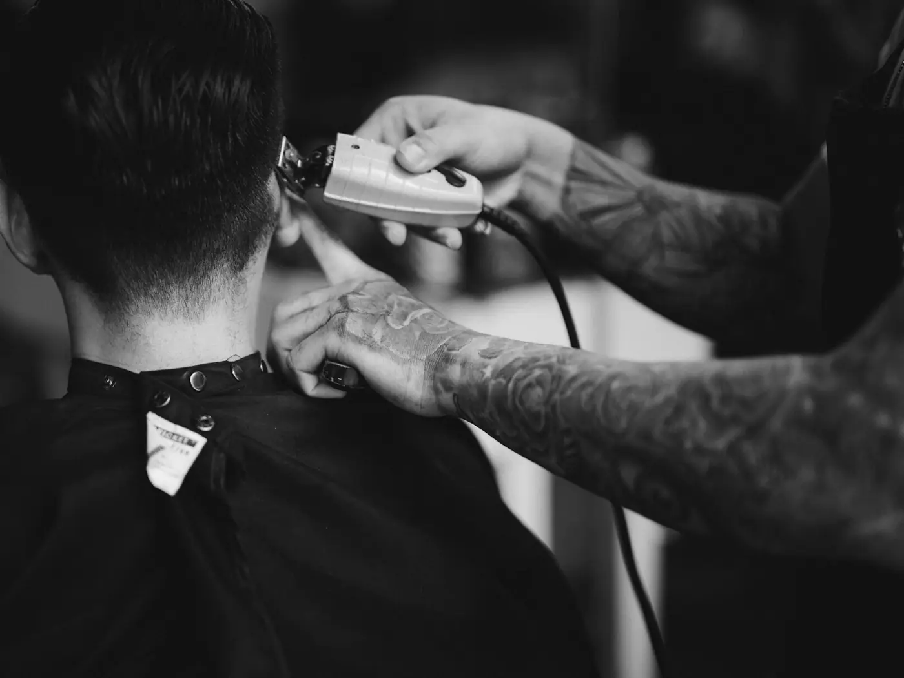
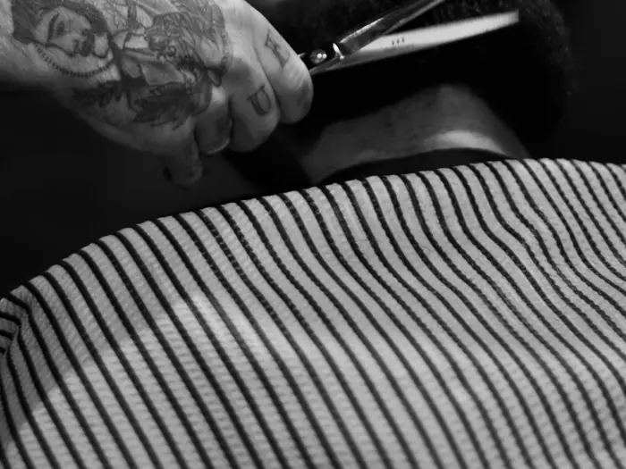
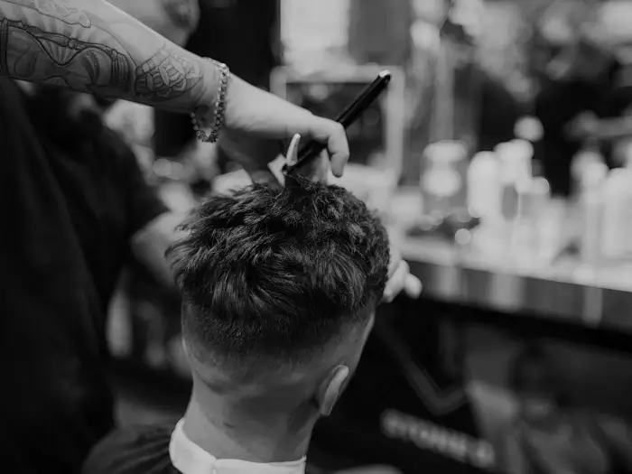

<main id="main" class="article-page">
    

      <nav class="article-breadcrumb" aria-label="Breadcrumb">
        <ol class="breadcrumb-list">
          <li class="breadcrumb-item">
            <a href="/" class="breadcrumb-link">Inicio</a>/
          </li>
          <li class="breadcrumb-item">
            <a href="/blog/" class="breadcrumb-link">Blog</a>/
          </li>
          <li class="breadcrumb-item">
            <a href="/categorias/tecnicas/" class="breadcrumb-link">Técnicas</a>/
          </li>
          <li class="breadcrumb-item">
            Cortes de barbería para hombre
          </li>
        </ol>
      </nav>
      

        

          <header class="article-hero-inline">
            <a href="/categorias/tecnicas/" class="article-category">Técnicas</a>
            <h1 class="article-title">
              Cortes de barbería para hombre: tipos, nombres y cómo elegir el tuyo
            </h1>
            

              Llegar a la barbería y no saber cómo se llama el corte que quieres es más común de lo que parece.
            

            

              

                

                  RB
                

                

                  Redacción Barberia.mxActualizado el 11 de septiembre de 2026
                

              

              

                10 min lectura
              

            

            
          </header>
          <article class="article-content">
            

              

                Llegar a la barbería y no saber cómo se llama el corte que quieres es más común de lo que parece. Esta guía reúne los cortes de barbería para hombre que más se piden en México, explica en qué se diferencia cada uno y te ayuda a elegir según tu tipo de cabello, la forma de tu rostro y el tiempo que quieres dedicarle a peinar tu cabello cada mañana.
              

              <h2>
                Tipos de cortes de barbería más populares
              </h2>
              

                Casi todos los cortes de pelo para hombre combinan dos decisiones: qué tan corto van los lados (con máquina, degradado o tijera) y cuánto largo se deja arriba. A partir de ahí salen los nombres que usan los barberos. A diferencia de una peluquería unisex, en la barbería el trabajo con máquina, degradado y navaja es la especialidad.
              

              <h3>
                Fade o degradado
              </h3>
              

                El fade es el corte clásico de barbería moderna: el cabello de los lados y la nuca se desvanece de corto a más largo, sin línea marcada. Según la altura donde empieza el desvanecimiento se habla de<strong>low fade</strong>(bajo, cerca de la oreja),<strong>mid fade</strong>(a media altura) y<strong>high fade</strong>(alto, casi en la sien). Si el degradado llega a la piel se llama<strong>skin fade</strong>o degradado a cero.
              

              <h3>
                Taper fade
              </h3>
              

                Es un degradado más discreto que solo se trabaja en patillas y nuca. Mantiene un aspecto limpio y formal, y es buena opción para oficina o para quien crece el cabello rápido y no quiere un cambio drástico.
              

              <h3>
                Burst fade
              </h3>
              

                El desvanecimiento hace un arco alrededor de la oreja y deja más largo en la nuca. Se combina seguido con mohicano o con mullet moderno.
              

              <h3>
                Undercut
              </h3>
              

                Lados muy cortos o rapados, sin degradado, y mucho más largo arriba. El contraste permite peinar hacia atrás, de lado o con textura. Funciona con cabello liso y grueso.
              

              <h3>
                Buzz cut
              </h3>
              

                Consiste en rapar con máquina a una sola medida: corto y uniforme en toda la cabeza. Es práctico, casi no requiere peinar y va bien con rostros de rasgos marcados.
              

              <h3>
                Crew cut y corte militar
              </h3>
              

                Parecido al buzz, pero con un poco más de largo arriba y al frente. Es un corte corto y ordenado que se mantiene con visitas frecuentes a la barbería.
              

              <h3>
                French crop
              </h3>
              

                Cabello corto con flequillo recto o texturizado hacia el frente y lados en degradado. Disimula entradas y es de los cortes en tendencia más pedidos en los últimos años.
              

              <h3>
                Pompadour y quiff
              </h3>
              

                Cortes con volumen arriba: el pompadour peina el cabello hacia atrás con altura; el quiff lo levanta al frente con un acabado más desenfadado. Ambos necesitan largo arriba, secadora y un producto de fijación como pomada o cera.
              

              <h3>
                Corte clásico con tijera (raya al lado)
              </h3>
              

                El corte clásico de caballero: lados más cortos trabajados con tijera, raya marcada y peinado hacia un lado. Es atemporal y se adapta a casi cualquier tipo de cabello.
              

              <h3>
                Mullet moderno y mohicano
              </h3>
              

                El mullet deja largo en la nuca y corto al frente y los lados; su versión actual suele llevar degradado. El mohicano concentra el cabello en una franja central; su variante suave, el faux hawk, no rapa por completo los lados.
              

              <h3>
                Cortes para cabello largo
              </h3>
              

                Si prefieres el cabello largo, pide un corte en capas con tijera que retire volumen, limpie la nuca y defina la forma. Se retoca cada 6 a 8 semanas y conviene peinar con crema o aceite ligero para controlar el frizz.
              

              <h3>
                Grecas y diseños
              </h3>
              

                Las grecas son líneas o figuras que el barbero dibuja con navaja o máquina sobre un degradado. Conviene pedirlas a un barbero con experiencia en diseño y retocarlas cada una o dos semanas.
              

              <h2>
                Cómo elegir tu corte según tu rostro y tu cabello
              </h2>
              <ul>
                <li>
                  <strong>Rostro redondo:</strong>busca altura arriba y lados cortos (fade alto, pompadour, quiff) para alargar visualmente.
                </li>
                <li>
                  <strong>Rostro alargado:</strong>evita demasiada altura; funcionan el french crop, el crew cut o un corte clásico con volumen a los lados.
                </li>
                <li>
                  <strong>Rostro cuadrado:</strong>casi todo le queda; el buzz cut y el undercut resaltan la mandíbula.
                </li>
                <li>
                  <strong>Cabello rizado u ondulado:</strong>aprovecha la textura natural con un fade bajo y más largo arriba; pide que corten en seco o con tijera.
                </li>
                <li>
                  <strong>Cabello liso y fino:</strong>los cortes con textura (french crop, crop texturizado) dan sensación de volumen.
                </li>
                <li>
                  <strong>Entradas o poca densidad:</strong>un corte corto y parejo o un french crop con flequillo disimula mejor que dejar largo arriba.
                </li>
              </ul>
              <h2>
                Tabla rápida: corte, mantenimiento y peinado
              </h2>
              

                <table class="seo-price-table seo-price-table--wide">
                  <thead>
                    <tr>
                      <th>
                        Corte
                      </th>
                      <th>
                        Retoque sugerido
                      </th>
                      <th>
                        Peinado diario
                      </th>
                    </tr>
                  </thead>
                  <tbody>
                    <tr>
                      <td data-label="Corte">
                        Skin fade / high fade
                      </td>
                      <td data-label="Retoque sugerido">
                        Cada 2 a 3 semanas
                      </td>
                      <td data-label="Peinado diario">
                        Mínimo
                      </td>
                    </tr>
                    <tr>
                      <td data-label="Corte">
                        Low fade / taper fade
                      </td>
                      <td data-label="Retoque sugerido">
                        Cada 3 a 4 semanas
                      </td>
                      <td data-label="Peinado diario">
                        Bajo
                      </td>
                    </tr>
                    <tr>
                      <td data-label="Corte">
                        Buzz cut / crew cut
                      </td>
                      <td data-label="Retoque sugerido">
                        Cada 2 a 4 semanas
                      </td>
                      <td data-label="Peinado diario">
                        Ninguno
                      </td>
                    </tr>
                    <tr>
                      <td data-label="Corte">
                        French crop
                      </td>
                      <td data-label="Retoque sugerido">
                        Cada 3 a 4 semanas
                      </td>
                      <td data-label="Peinado diario">
                        Bajo, con producto mate
                      </td>
                    </tr>
                    <tr>
                      <td data-label="Corte">
                        Undercut / pompadour
                      </td>
                      <td data-label="Retoque sugerido">
                        Cada 3 a 5 semanas
                      </td>
                      <td data-label="Peinado diario">
                        Alto: secadora y pomada
                      </td>
                    </tr>
                    <tr>
                      <td data-label="Corte">
                        Corte clásico con tijera
                      </td>
                      <td data-label="Retoque sugerido">
                        Cada 4 a 6 semanas
                      </td>
                      <td data-label="Peinado diario">
                        Medio
                      </td>
                    </tr>
                  </tbody>
                </table>
              

              <h2>
                Cómo pedir tu corte en la barbería
              </h2>
              <ol>
                <li>
                  Lleva una foto del corte de pelo que quieres, de frente y de perfil.
                </li>
                <li>
                  Di la medida o el número de máquina si ya la conoces, y hasta dónde quieres el degradado (bajo, medio o alto).
                </li>
                <li>
                  Aclara cuánto largo quieres conservar arriba y si peinas hacia atrás, de lado o con textura.
                </li>
                <li>
                  Pregunta qué producto recomienda el barbero para tu tipo de cabello y cómo peinarlo en casa.
                </li>
              </ol>
              <h2>
                Dónde hacerte un corte de barbería
              </h2>
              

                En el <a href="/directorio/">directorio de barberías</a> de Barberia.mx puedes comparar servicios, precios publicados y horario antes de agendar.
                En CDMX, las fichas de <a href="/ciudad-de-mexico/">barberías en CDMX</a> muestran el precio del corte y del corte con barba, y el contacto directo por WhatsApp o teléfono.
                Si todavía no sabes a cuál ir, revisa la guía para <a href="/articulos/como-encontrar-barberia-cerca-de-ti/">encontrar una barbería cerca de mí</a> y la <a href="/articulos/rutina-grooming-hombre-moderno-guia-completa/">rutina de grooming para hombre</a> para mantener el corte entre visitas.
              

              <h2>
                Preguntas frecuentes sobre cortes de barbería
              </h2>
              

                <article class="seo-faq-item">
                  <h3>
                    ¿Qué tipos de cortes hay en barbería?
                  </h3>
                  

                    Los más comunes son el fade o degradado (low, mid, high y skin fade), el taper fade, el undercut, el buzz cut, el crew cut, el french crop, el pompadour, el quiff, el corte clásico con tijera, el mullet moderno y el mohicano, además de las grecas o diseños.
                  

                </article>
                <article class="seo-faq-item">
                  <h3>
                    ¿Cuál es la diferencia entre fade y taper?
                  </h3>
                  

                    El fade desvanece todo el contorno de los lados y la nuca; el taper solo se trabaja en patillas y nuca, por lo que se ve más discreto.
                  

                </article>
                <article class="seo-faq-item">
                  <h3>
                    ¿Cada cuánto debo cortarme el pelo?
                  </h3>
                  

                    Los cortes muy cortos o con degradado a la piel se retocan cada 2 a 3 semanas; los cortes clásicos con tijera aguantan de 4 a 6 semanas.
                  

                </article>
                <article class="seo-faq-item">
                  <h3>
                    ¿Qué corte disimula las entradas?
                  </h3>
                  

                    Un corte corto y parejo, como el crew cut, o un french crop con flequillo al frente disimulan mejor las entradas que dejar mucho largo arriba.
                  

                </article>
              

            

            <footer class="article-footer">
              

                Compartir<a href="https://www.facebook.com/sharer/sharer.php?u=https://barberia.mx/articulos/cortes-de-barberia-para-hombre/" class="share-btn" target="_blank" rel="noopener nofollow">Facebook</a><a href="https://wa.me/?text=https://barberia.mx/articulos/cortes-de-barberia-para-hombre/" class="share-btn" target="_blank" rel="noopener nofollow">WhatsApp</a>
              

            </footer>
          </article>
        

      

      <section class="related-articles">
        <h2 class="related-title">
          Artículos relacionados
        </h2>
        

          <a href="/articulos/historia-de-la-barberia/" class="related-card">
          

            
          

          

            <h3 class="related-card-title">
              Historia de la barbería: origen, evolución y el caramelo
            </h3>
            Estilo de vida · 9 min
          

          </a><a href="/articulos/rutina-grooming-hombre-moderno-guia-completa/" class="related-card">
          

            
          

          

            <h3 class="related-card-title">
              Rutina de grooming para hombre
            </h3>
            Estilo de vida · 18 min
          

          </a><a href="/articulos/como-encontrar-barberia-cerca-de-ti/" class="related-card">
          

            
          

          

            <h3 class="related-card-title">
              Cómo encontrar una barbería cerca de ti
            </h3>
            Guía · 9 min
          

          </a>
        

      </section>
    

  

</main>
