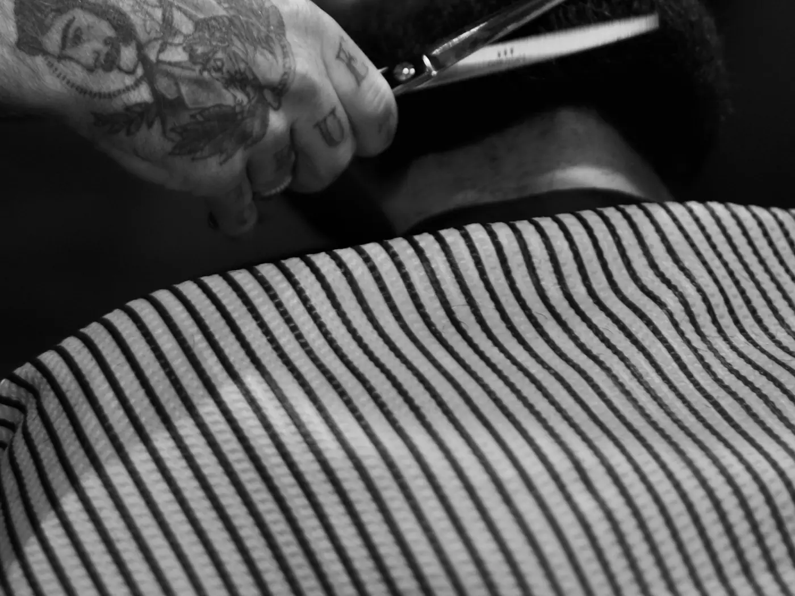
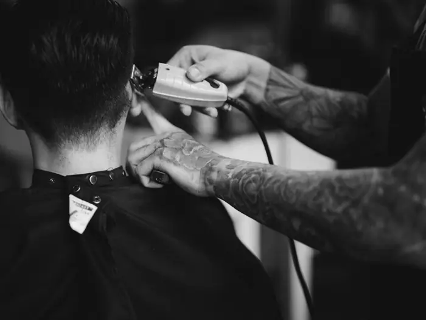
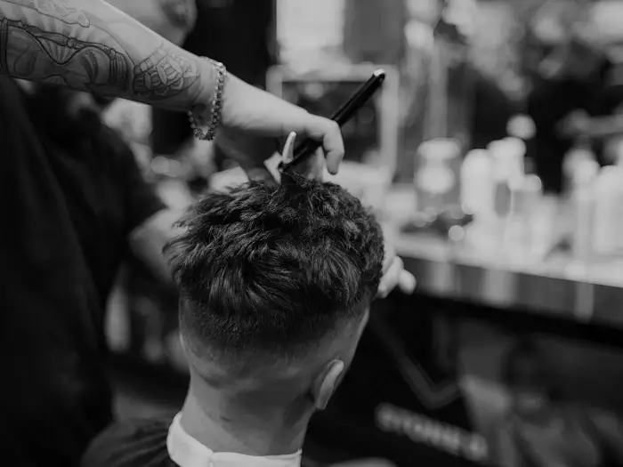

<main id="main" class="article-page">
    

      <nav class="article-breadcrumb" aria-label="Breadcrumb">
        <ol class="breadcrumb-list">
          <li class="breadcrumb-item">
            <a href="/" class="breadcrumb-link">Inicio</a>/
          </li>
          <li class="breadcrumb-item">
            <a href="/blog/" class="breadcrumb-link">Blog</a>/
          </li>
          <li class="breadcrumb-item">
            <a href="/categorias/estilo-de-vida/" class="breadcrumb-link">Estilo de vida</a>/
          </li>
          <li class="breadcrumb-item">
            Historia de la barbería
          </li>
        </ol>
      </nav>
      

        

          <header class="article-hero-inline">
            <a href="/categorias/estilo-de-vida/" class="article-category">Estilo de vida</a>
            <h1 class="article-title">
              Historia de la barbería: origen, evolución y el significado del caramelo
            </h1>
            

              La barbería es uno de los oficios más antiguos del mundo.
            

            

              

                

                  RB
                

                

                  Redacción Barberia.mxActualizado el 11 de septiembre de 2026
                

              

              

                9 min lectura
              

            

            
          </header>
          <article class="article-content">
            

              

                La barbería es uno de los oficios más antiguos del mundo. Durante siglos el barbero no solo cortaba el cabello y arreglaba la barba: también sacaba muelas, hacía sangrías y atendía heridas. Esta es la historia de la barbería, desde el antiguo Egipto hasta la barbería moderna, y la explicación de por qué el caramelo de barbería tiene esos colores.
              

              <h2>
                El origen de la barbería
              </h2>
              <h3>
                Antiguo Egipto
              </h3>
              

                En el antiguo Egipto ya se usaban navajas de piedra y después de bronce para afeitar la cara y la cabeza. El vello se asociaba con falta de limpieza, así que sacerdotes y personas de alto rango se afeitaban con frecuencia. Quien dominaba la navaja tenía un lugar de confianza cerca de las familias importantes.
              

              <h3>
                Antigua Grecia
              </h3>
              

                En Grecia la barba era símbolo de sabiduría y se cuidaba con esmero. Los barberos recortaban y daban forma a barbas y cabello, y su local se volvió un lugar de encuentro para conversar de política y noticias, una tradición que la barbería conserva hasta hoy.
              

              <h3>
                Roma y los tonsores
              </h3>
              

                Plinio el Viejo cuenta que los primeros barberos llegaron a Roma desde Sicilia alrededor del año 300 a. C., traídos por Ticinius Mena. Los romanos los llamaban<em>tonsores</em>y a la barbería,<em>tonstrina</em>. El primer afeitado de un joven era un rito de paso que marcaba su llegada a la edad adulta.
              

              <h2>
                Barberos cirujanos en la Edad Media
              </h2>
              

                En la Europa medieval los barberos manejaban navajas y cuchillas con más destreza que nadie, así que asumieron procedimientos médicos: sangrías, extracción dental, curación de heridas e incluso amputaciones y otras cirugías menores. Suele citarse el Concilio de Tours de 1163 como el momento en que se prohibió al clero practicar actos en los que corriera sangre, lo que dejó ese trabajo en manos de los barberos.
              

              

                Con el tiempo el oficio se organizó en gremios de barberos. En Inglaterra, Enrique VIII unió en 1540 a barberos y cirujanos en una misma compañía; la separación llegó en 1745, cuando los cirujanos formaron su propia corporación y los barberos se quedaron con el cabello y la barba. En Francia, Ambroise Paré empezó como barbero cirujano y llegó a ser cirujano de la corte.
              

              

                En la Nueva España también existió la figura del barbero flebotomiano, que además de cortar el cabello hacía sangrías y extracciones, y cuyo ejercicio supervisaban las autoridades médicas del virreinato.
              

              <h2>
                Qué significan los colores del caramelo de barbería
              </h2>
              

                El caramelo de barbería, también llamado poste de barbería o<em>barber pole</em>, nació en la época de los barberos cirujanos. La explicación más aceptada es esta:
              

              <ul>
                <li>
                  <strong>Rojo:</strong>la sangre de las sangrías.
                </li>
                <li>
                  <strong>Blanco:</strong>las vendas que se lavaban y se colgaban a secar alrededor de un palo afuera del local.
                </li>
                <li>
                  <strong>El poste:</strong>el bastón que el paciente apretaba con la mano durante la sangría para que la vena se marcara.
                </li>
                <li>
                  <strong>Azul:</strong>se añadió después, sobre todo en Estados Unidos; unos lo relacionan con la bandera y otros con la sangre venosa.
                </li>
              </ul>
              

                Hoy el caramelo de barbería es un símbolo del oficio. Los modelos más comunes son el caramelo giratorio con luz LED, el de pared para interior y el de exterior resistente a la lluvia; se diferencian por tamaño, material y si tienen motor e iluminación. Si vas a comprar uno para tu barbería, compara la medida, el tipo de montaje y el consumo de la luz.
              

              <h2>
                La barbería moderna
              </h2>
              

                A finales del siglo XIX aparecieron las primeras escuelas para formar barberos; la que suele citarse como la primera escuela de barbería abrió en Chicago en 1893. A principios del siglo XX la navaja de seguridad permitió afeitarse en casa, y en los años sesenta y setenta el cabello largo y las estéticas unisex hicieron que muchas barberías tradicionales cerraran.
              

              

                Desde la década de 2010 la barbería vivió un regreso: la barba volvió a ponerse de moda, surgieron barberías de estilo vieja escuela y el cuidado personal masculino se profesionalizó con servicios como el afeitado con navaja y toalla caliente, el perfilado de barba, el fade y los tratamientos faciales.
              

              <h2>
                Línea del tiempo de la barbería
              </h2>
              

                <table class="seo-price-table seo-price-table--wide">
                  <thead>
                    <tr>
                      <th>
                        Época
                      </th>
                      <th>
                        Hito
                      </th>
                    </tr>
                  </thead>
                  <tbody>
                    <tr>
                      <td data-label="Época">
                        Antiguo Egipto
                      </td>
                      <td data-label="Hito">
                        Navajas de piedra y bronce; el afeitado como señal de limpieza.
                      </td>
                    </tr>
                    <tr>
                      <td data-label="Época">
                        Antigua Grecia
                      </td>
                      <td data-label="Hito">
                        La barbería como lugar de encuentro y conversación.
                      </td>
                    </tr>
                    <tr>
                      <td data-label="Época">
                        Roma, c. 300 a. C.
                      </td>
                      <td data-label="Hito">
                        Llegan los primeros tonsores desde Sicilia, según Plinio el Viejo.
                      </td>
                    </tr>
                    <tr>
                      <td data-label="Época">
                        Edad Media
                      </td>
                      <td data-label="Hito">
                        Barberos cirujanos: sangrías, extracciones y cirugías menores.
                      </td>
                    </tr>
                    <tr>
                      <td data-label="Época">
                        1540 y 1745
                      </td>
                      <td data-label="Hito">
                        En Inglaterra se unen y luego se separan barberos y cirujanos.
                      </td>
                    </tr>
                    <tr>
                      <td data-label="Época">
                        1893
                      </td>
                      <td data-label="Hito">
                        Se abre en Chicago la que suele citarse como primera escuela de barbería.
                      </td>
                    </tr>
                    <tr>
                      <td data-label="Época">
                        Años 60 y 70
                      </td>
                      <td data-label="Hito">
                        Declive de la barbería clásica frente a las estéticas unisex.
                      </td>
                    </tr>
                    <tr>
                      <td data-label="Época">
                        Década de 2010
                      </td>
                      <td data-label="Hito">
                        Resurgimiento de la barbería y del cuidado de la barba.
                      </td>
                    </tr>
                  </tbody>
                </table>
              

              <h2>
                Diferencia entre barbería y peluquería
              </h2>
              

                La peluquería trabaja el cabello de cualquier persona, con peinados, tintes y tratamientos.
                La barbería se especializa en el hombre: cortes con máquina y degradado, trabajo con navaja, arreglo y cuidado de la barba y afeitado tradicional.
                Si quieres conocer los estilos que más se piden, revisa la guía de <a href="/articulos/cortes-de-barberia-para-hombre/">cortes de barbería para hombre</a>; y para encontrar dónde ir, el <a href="/directorio/">directorio de barberías</a> y las fichas de <a href="/ciudad-de-mexico/">barberías en CDMX</a>.
              

              <h2>
                Preguntas frecuentes sobre la historia de la barbería
              </h2>
              

                <article class="seo-faq-item">
                  <h3>
                    ¿Dónde nació la barbería?
                  </h3>
                  

                    Hay registros de barberos y navajas en el antiguo Egipto; el oficio se extendió por Grecia y Roma, donde la barbería ya era un negocio establecido.
                  

                </article>
                <article class="seo-faq-item">
                  <h3>
                    ¿Quién fue el primer barbero de la historia?
                  </h3>
                  

                    No se conoce un primer barbero con nombre. En Roma, Plinio el Viejo atribuye a Ticinius Mena haber llevado a los primeros barberos desde Sicilia hacia el año 300 a. C.
                  

                </article>
                <article class="seo-faq-item">
                  <h3>
                    ¿Por qué los barberos eran también cirujanos?
                  </h3>
                  

                    Porque dominaban la navaja y los instrumentos cortantes. En la Edad Media hacían sangrías, extracciones dentales y cirugías menores, hasta que cirujanos y barberos se separaron como profesiones.
                  

                </article>
                <article class="seo-faq-item">
                  <h3>
                    ¿Qué significan los 3 colores del caramelo de barbería?
                  </h3>
                  

                    El rojo representa la sangre, el blanco las vendas y el azul, añadido después, se asocia con la bandera de Estados Unidos o con la sangre venosa.
                  

                </article>
              

            

            <footer class="article-footer">
              

                Compartir<a href="https://www.facebook.com/sharer/sharer.php?u=https://barberia.mx/articulos/historia-de-la-barberia/" class="share-btn" target="_blank" rel="noopener nofollow">Facebook</a><a href="https://wa.me/?text=https://barberia.mx/articulos/historia-de-la-barberia/" class="share-btn" target="_blank" rel="noopener nofollow">WhatsApp</a>
              

            </footer>
          </article>
        

      

      <section class="related-articles">
        <h2 class="related-title">
          Artículos relacionados
        </h2>
        

          <a href="/articulos/cortes-de-barberia-para-hombre/" class="related-card">
          

            
          

          

            <h3 class="related-card-title">
              Cortes de barbería para hombre: tipos y cómo elegir
            </h3>
            Técnicas · 10 min
          

          </a><a href="/articulos/rutina-grooming-hombre-moderno-guia-completa/" class="related-card">
          

            
          

          

            <h3 class="related-card-title">
              Rutina de grooming para hombre
            </h3>
            Estilo de vida · 18 min
          

          </a><a href="/articulos/como-encontrar-barberia-cerca-de-ti/" class="related-card">
          

            
          

          

            <h3 class="related-card-title">
              Cómo encontrar una barbería cerca de ti
            </h3>
            Guía · 9 min
          

          </a>
        

      </section>
    

  

</main>
